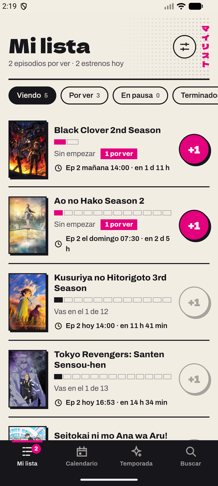
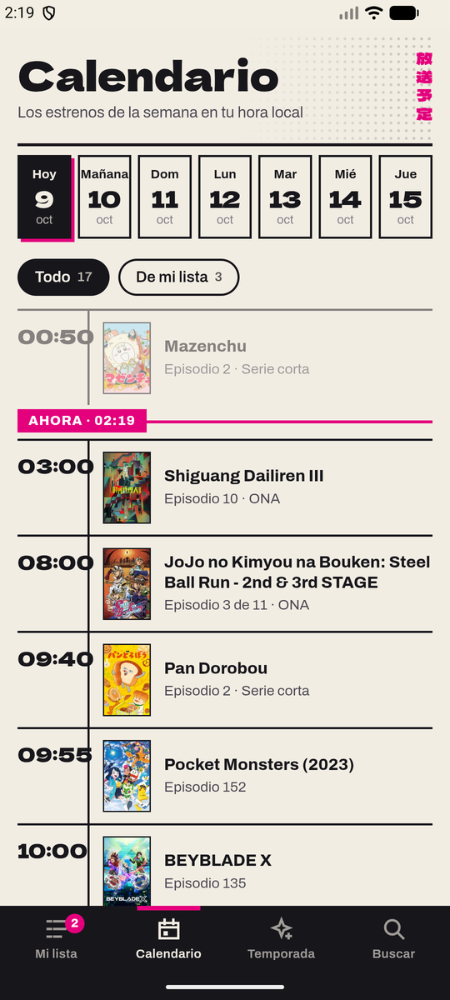
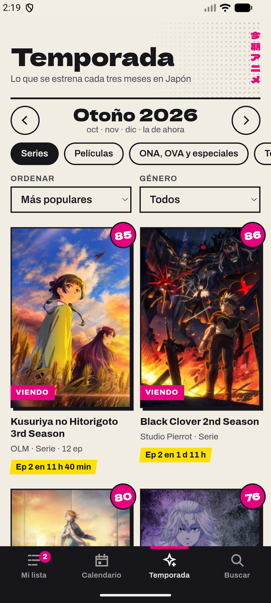
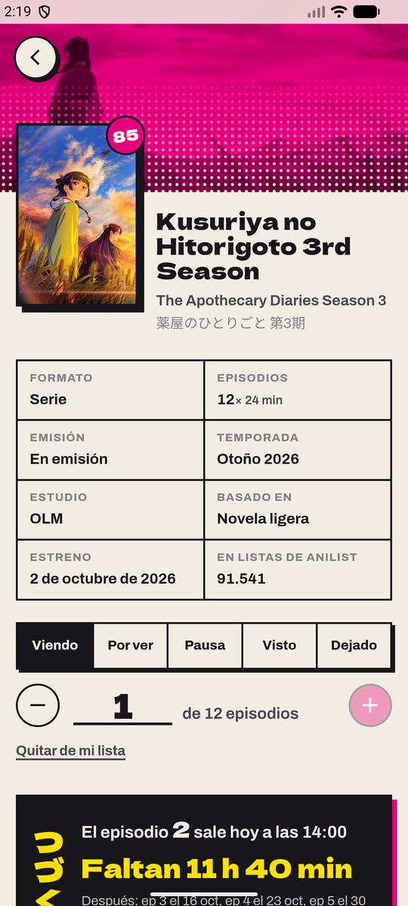
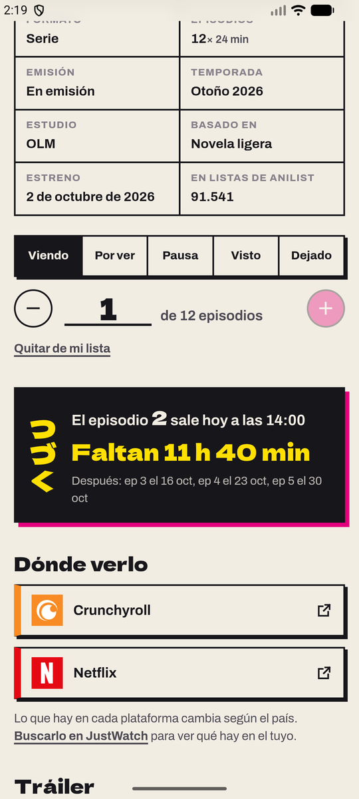
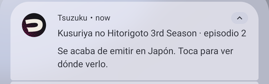

# Tsuzuku

Quería una sola app para saber en qué episodio voy de cada anime, cuándo sale el siguiente y en qué
plataforma lo puedo ver, sin pasar por páginas piratas. Tsuzuku (つづく, el «continuará» que sale al
final de cada episodio) es eso: una web y una app de Android que llevan tu lista, te muestran la
temporada y el calendario de estrenos, y te avisan cuando sale un episodio de lo que estás viendo.

Tsuzuku no tiene episodios. El botón de cada anime te lleva a Crunchyroll, Netflix o la plataforma
donde esté.

<p align="center">
  
  
  
  
  
</p>

## Qué hace

«Mi lista» separa lo que estás viendo, lo que dejaste para después, lo pausado, lo terminado y lo
abandonado. En «Viendo», cada anime tiene una barra con un recuadro por episodio: en negro lo que
viste y en magenta lo que ya salió y te falta. El botón «+1» marca el siguiente, y no deja marcar
episodios que todavía no se emiten. Arriba van primero los que tienen algo por ver y después los
que salen antes.

«Calendario» es una guía de programación de la semana, en tu hora local, con una línea que marca
la hora actual. Señala los estrenos, los finales y lo que está en tu lista.

«Temporada» muestra lo que se estrena cada tres meses en Japón, por popularidad o por nota, con
filtros de formato y género. Se puede ir a temporadas pasadas o a la siguiente.

«Buscar» encuentra por nombre (en romaji, inglés o japonés) o por género. Sin texto, muestra lo que
más se está viendo.

La ficha de cada anime tiene sus datos, la cuenta regresiva al próximo episodio, las plataformas
donde está, el tráiler, la sinopsis, los personajes con sus voces, lo relacionado (precuelas,
secuelas) y recomendaciones.

En Android, Tsuzuku te avisa cuando se emite un episodio de lo que estás viendo, y al tocar el aviso
abre la ficha. Los avisos se programan en el teléfono con las fechas que publica AniList, sin
servidor.

<p align="center">
  
</p>

En Ajustes eliges si los títulos salen en romaji, en inglés o en japonés, traes tu lista de AniList
con tu usuario (si es pública) y guardas o abres un respaldo.

## Hecho con

Svelte 5 y TypeScript sobre Vite, y Capacitor 8 para el APK (con sus plugins de avisos locales,
archivos y compartir). Los datos salen de la [API GraphQL de AniList](https://docs.anilist.co), que
es pública y no pide clave. No hay servidor propio: la lista se guarda en el dispositivo.

| Archivo | Para qué |
| --- | --- |
| `src/lib/anilist.ts` | Las consultas a AniList, con caché y respetando su límite de 30 consultas por minuto. |
| `src/lib/lista.svelte.ts` | Tu lista: guardarla, ponerla al día, importar de AniList y los respaldos. |
| `src/lib/avisos.ts` | Programar los avisos de estreno en Android. |
| `src/lib/estado.svelte.ts` | Preferencias, navegación con el hash de la dirección y los avisos en pantalla. |
| `src/lib/formato.ts` | Géneros, formatos y temporadas en español; fechas, horas y cuentas regresivas. |
| `src/lib/texto.ts` | Limpiar la sinopsis y traducirla con el traductor del navegador, donde lo hay. |
| `src/pantallas/` | Mi lista, Calendario, Temporada, Buscar, la ficha y Ajustes. |
| `scripts/fuente.py` | Recorta la fuente de los títulos a lo que usa la app (28 KB en vez de casi un mega). |
| `scripts/icono.py` | Dibuja el ícono de la web y los de Android a partir de la misma fuente. |

El diseño imita una revista de manga semanal: papel de periódico, tinta negra, los tres colores de
imprenta y tramas de puntos. Los títulos van en Dela Gothic One y el texto en Archivo. Tiene modo
oscuro y en pantallas anchas la barra de pestañas pasa a la izquierda.

Los detalles técnicos y las decisiones están en [docs/como-funciona.md](docs/como-funciona.md).

## Arrancar

Hace falta Node 22 o más nuevo.

```bash
npm install
npm run dev
```

`npm run check` revisa los tipos con svelte-check.

## Compilar el APK

Hace falta además el JDK 21 y el SDK de Android.

```bash
npm run build
npx cap sync android
cd android && ./gradlew assembleDebug
```

El APK queda en `android/app/build/outputs/apk/debug/app-debug.apk`. Funciona desde Android 7.

## Publicar la web

El `Dockerfile` compila con Node y sirve el resultado con nginx. `nginx.conf` pone caché larga a
`/assets/`, revalida siempre el HTML y tiene una política de contenido que solo deja salir a AniList,
a las miniaturas de YouTube y a su reproductor de tráileres.

## In English

Tsuzuku is an anime tracker for the web and Android, built with Svelte 5, TypeScript and Capacitor
on top of the public AniList GraphQL API. It keeps your watch list with per-episode progress, shows
the current season and a weekly airing schedule in your local time, links each show to the legal
streaming platforms that carry it, and schedules local Android notifications when a new episode
airs. There is no backend: the list lives on the device. The app and docs are in Spanish.
